<p align="center">
  
</p>

<h1 align="center">simp2puml</h1>

<p align="center">
  <strong>Écrivez un diagramme, il se dessine.</strong><br>
  Un éditeur PlantUML natif à l'aperçu vectoriel, et un convertisseur entre SIMP, PlantUML et Atelier Diagrammes.
</p>

**[Site et documentation](https://simp2puml.sethmartin.dev) · [Installation](docs/installation.md) · [Guide de l'éditeur](docs/editeur.md)**

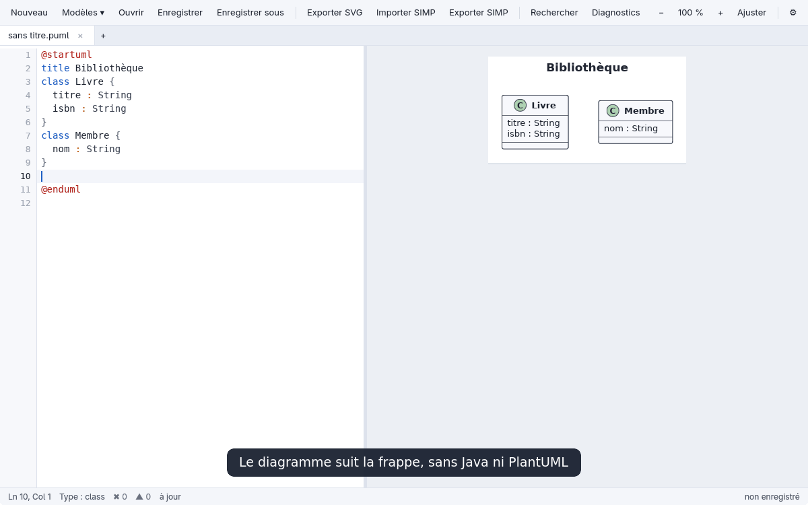

<sub>Enregistrements de la vraie application, pilotée pas à pas. Le pointeur et les légendes sont ajoutés au montage.</sub>

## Ce qu'il fait

| | |
| --- | --- |
| **Le diagramme répond au clic.** Un clic sur une propriété ramène à sa ligne, un Ctrl+clic au caractère près. Les flèches se cliquent sur toute leur longueur, et un petit menu tranche là où elles se croisent. | 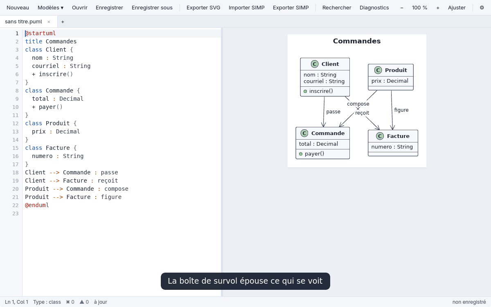 |
| **Il aide à écrire.** Autocomplétion selon le contexte, noms déclarés dans le document, erreurs signalées à leur ligne. | 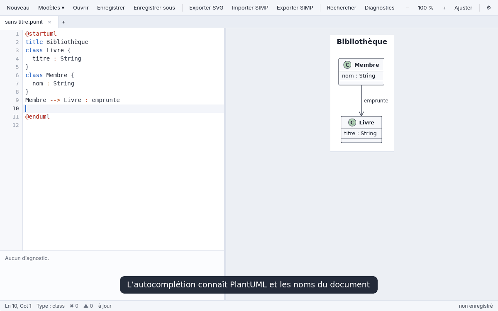 |
| **Net à tous les zooms.** L'aperçu est dessiné en vectoriel, sans image bitmap. Dans le texte, `Ctrl++` agrandit le texte plutôt que le diagramme. | 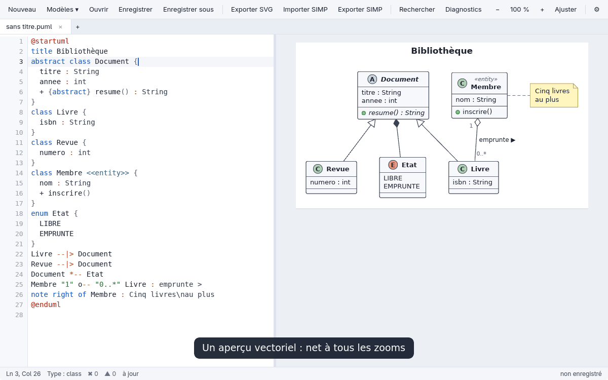 |
| **À votre goût.** Thème clair ou sombre, diagramme sur feuille claire ou aux couleurs adaptées ; tout s'applique aussitôt. | 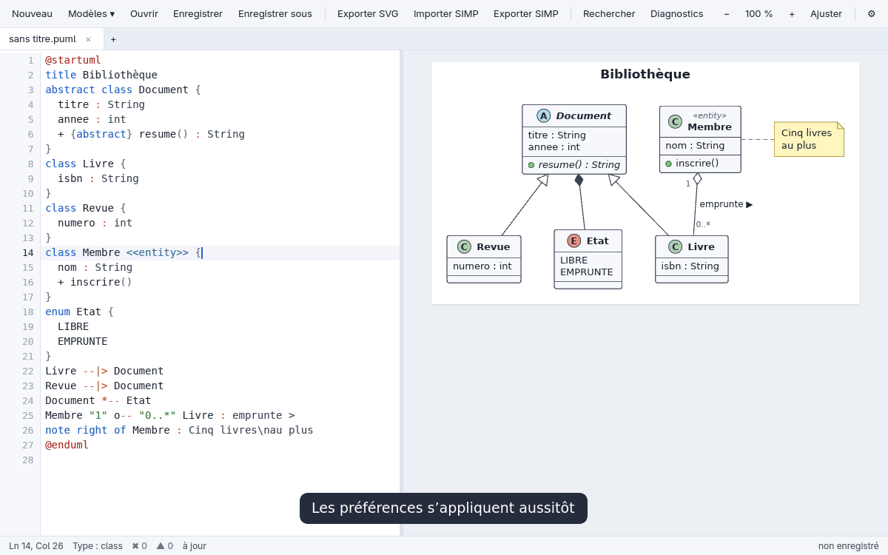 |
| **Sans Java.** Le moteur natif `pumlrender` rend classes, séquences, activités, états, cartes mentales, Gantt et d'autres encore. PlantUML officiel reste disponible d'un clic dans les préférences. | 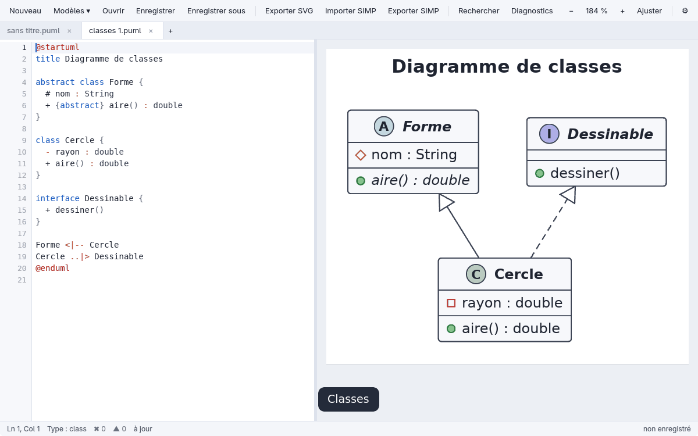 |
| **SIMP inclus.** Un projet SIMP s'ouvre dans un nouvel onglet, sans rien écrire à côté de la source. | 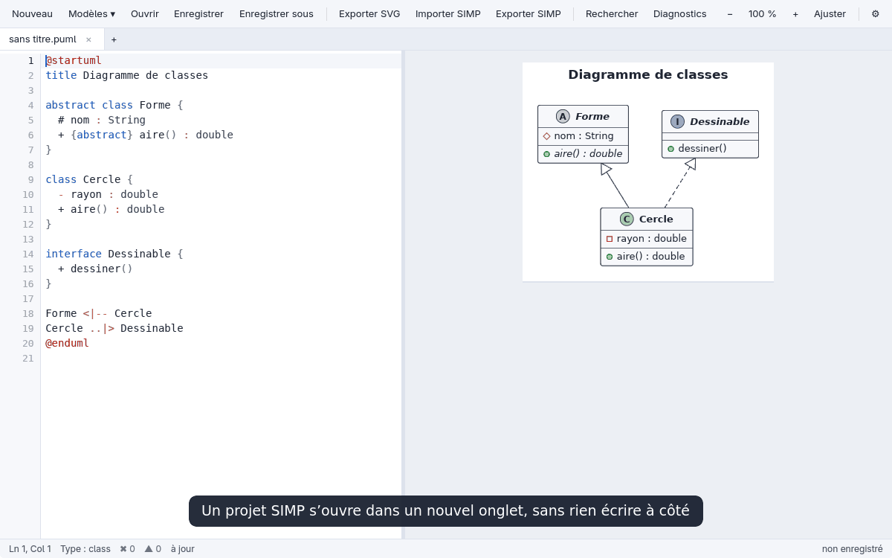 |

## Les diagrammes

<table>
  <tr>
    <td align="center">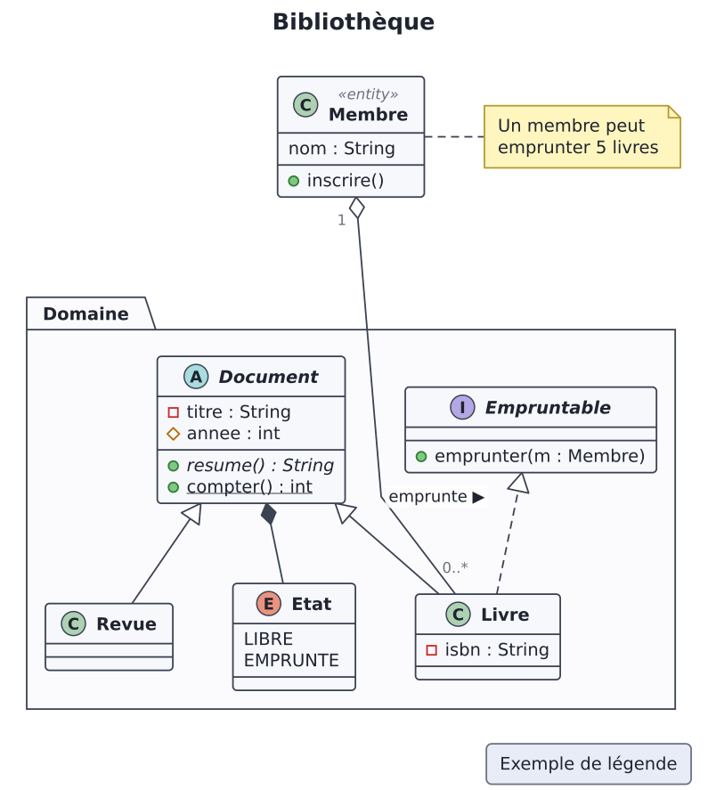<br>Classes</td>
    <td align="center">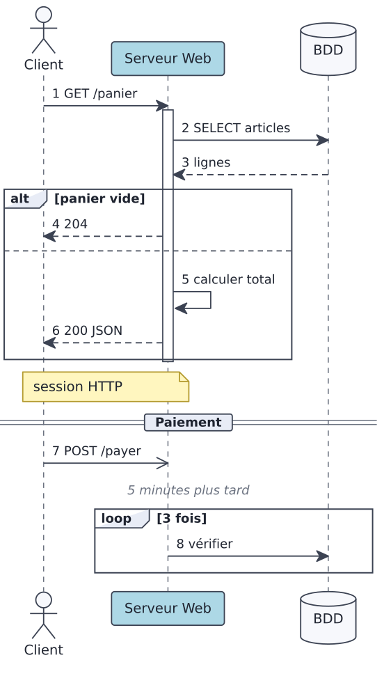<br>Séquence</td>
    <td align="center">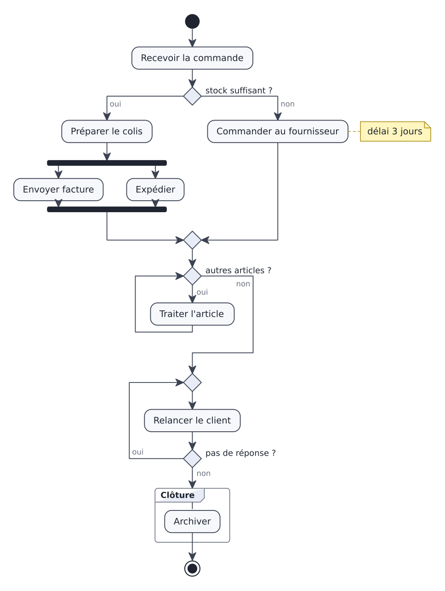<br>Activité</td>
  </tr>
  <tr>
    <td align="center">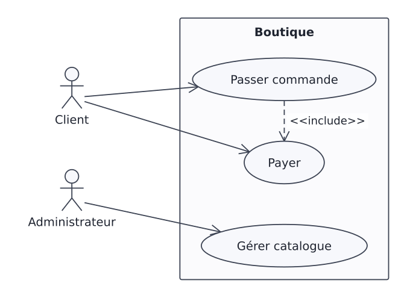<br>Cas d'utilisation</td>
    <td align="center">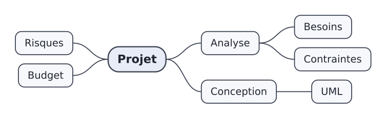<br>Carte mentale</td>
    <td align="center">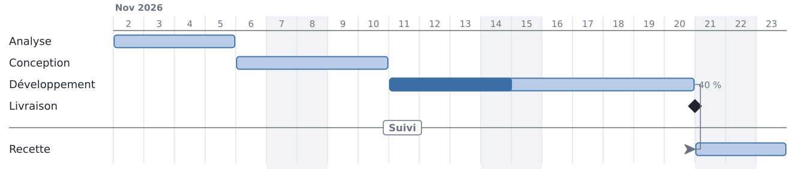<br>Gantt</td>
  </tr>
</table>

Rendus par le moteur natif à partir de [`renderer/tests/samples/`](renderer/tests/samples/). Le rendu n'est pas identique à celui de PlantUML : voir [Moteur de rendu natif](docs/moteur.md).

## Démarrer

L'éditeur se construit depuis les sources, avec Nim ≥ 1.6 et Rust stable. Aucune version précompilée n'est publiée pour l'instant.

```sh
git clone https://git.sethmartin.dev/Seth_Martin/simp2puml.git
cd simp2puml/renderer && nimble build
cd ../editor && cargo build --release
./target/release/puml-editor diagramme.puml
```

Le convertisseur seul s'installe avec pipx, et ne dépend que de Python ≥ 3.11 :

```sh
pipx install .
simp2puml diagramme.simp -o resultat.puml
```

Sans rien connaître de Python, les lanceurs à double-cliquer installent le nécessaire : voir [Installation](docs/installation.md), avec les en-têtes requis sous Linux.

## Documentation

- [Installation](docs/installation.md) : éditeur, lanceurs à double-cliquer, pipx.
- [L'éditeur](docs/editeur.md) : écriture, clics, préférences, profils de sécurité, raccourcis.
- [Moteur de rendu natif](docs/moteur.md) : types couverts, usage seul, performances mesurées.
- [Conversion en ligne de commande](docs/conversion.md) : options, codes de sortie, mode strict.
- [Couverture et limites](docs/couverture.md) : ce que chaque famille SIMP devient, et ce qui se perd.
- [Export vers Atelier Diagrammes](docs/atelier.md) : le DSL 2.0 pour Typst.
- [Interface classique](docs/interface-classique.md) : l'interface Tkinter, sans dépendance.
- [Développement](docs/developpement.md) : organisation, tests, paquets natifs.

## Le convertisseur

Outil en ligne de commande et interface graphique pour convertir des diagrammes SIMP vers PlantUML, et expérimentalement de PlantUML vers SIMP. Les deux formats s’exportent aussi vers le DSL 2.0 d’[Atelier Diagrammes](https://git.sethmartin.dev/Seth_Martin/atelier-diagrammes) (blocs Typst `diagramme-ad`). Python ≥ 3.11 ; aucune dépendance tierce à l’exécution. Le modèle commun conserve les identités, classifieurs, membres, relations, notes et avertissements, sans reproduire fidèlement toutes les données du format source.

## Origine et crédits

Ce projet reprend le convertisseur créé par **ASaki**, disponible dans le [dépôt GitHub d’origine de Nela](https://github.com/2534296-Mailloux-Nela/simp2puml). Merci à ASaki pour le travail initial sur la conversion SIMP et PlantUML, la CLI et le packaging.

Cette version ajoute des corrections de fidélité, des options de vérification et des diagnostics plus précis. La [licence MIT](LICENSE) et la mention de copyright d’origine de Nela sont conservées.
