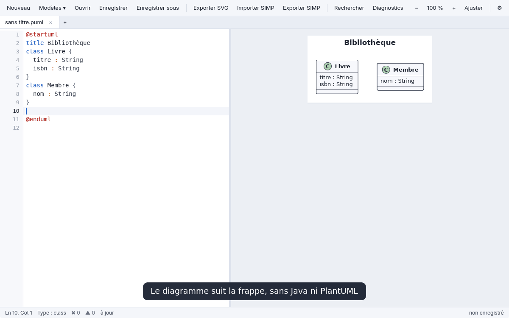
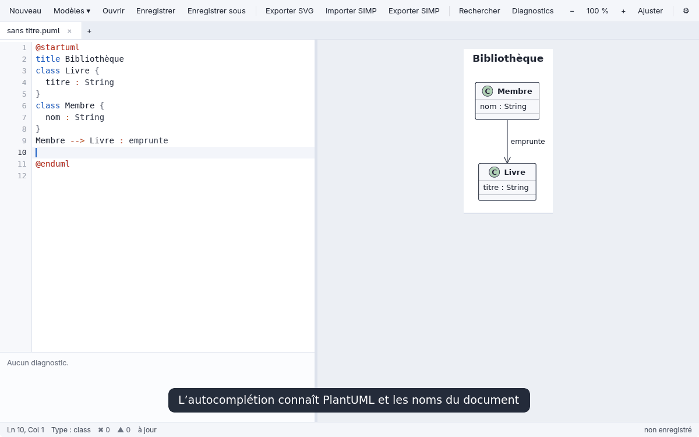
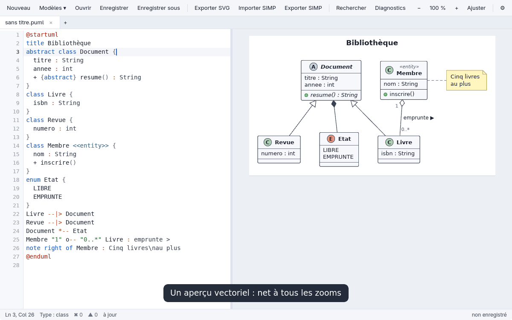
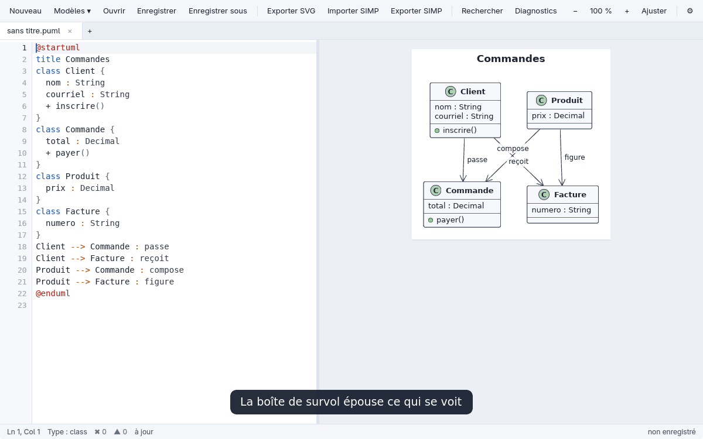
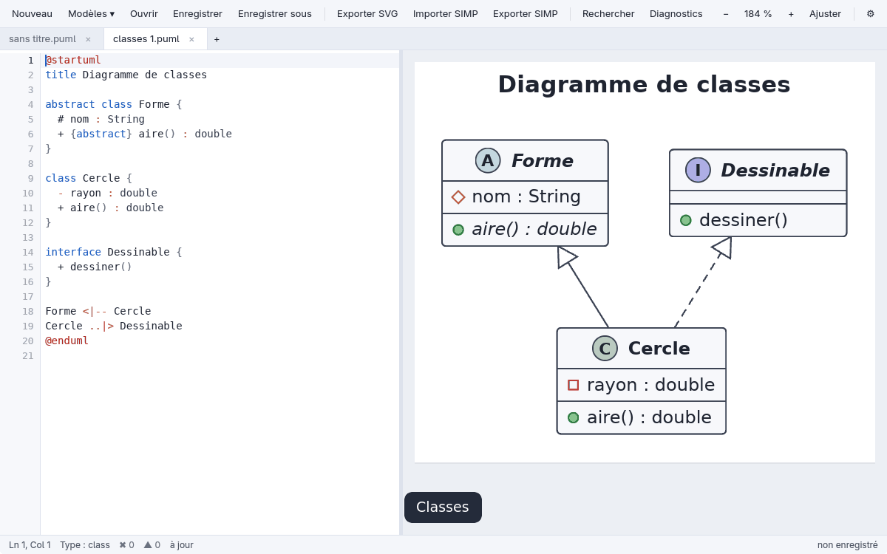
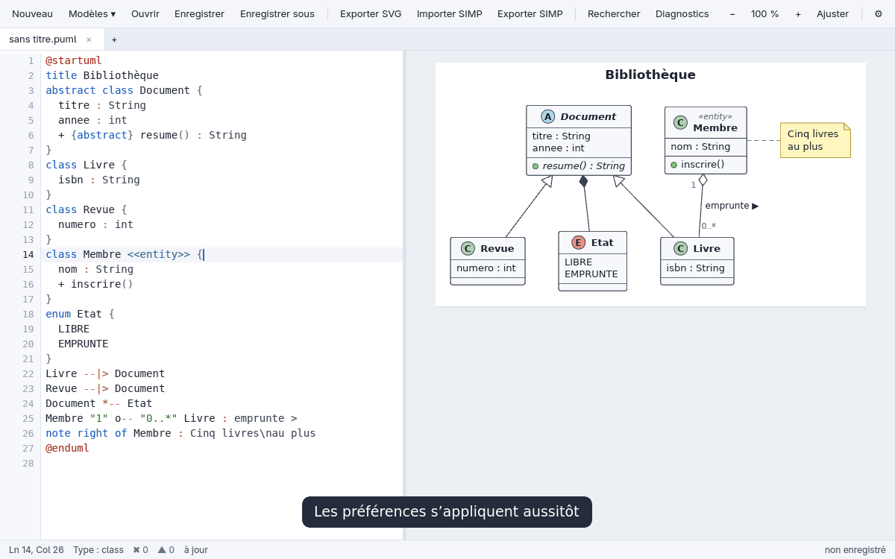
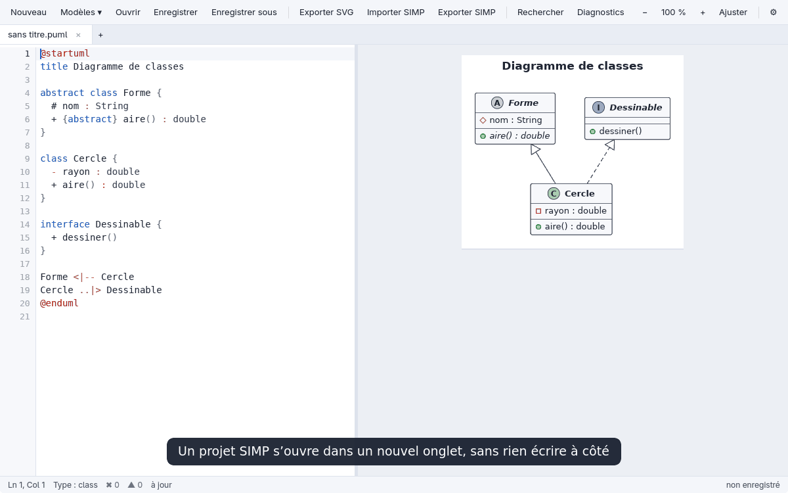

# L'éditeur simp2puml

L'éditeur est une application de bureau, déployée sous le nom **simp2puml** (titre `fichier — simp2puml 0.1.0`, entrée de menu `simp2puml`) ; son binaire est `puml-editor`. Il est indépendant du paquet Python, qu'il appelle seulement pour importer et exporter le format SIMP. Il est écrit en Rust avec [GPUI](https://gpui.rs), le cadriciel d'interface de Zed.

Pour l'obtenir, voir [Installation](installation.md).

## Écrire

Onglets, coloration syntaxique, autocomplétion (mots-clés selon le contexte, noms déclarés dans le document, flèches, extraits, avec correspondance approximative), numéros de ligne, annulation/rétablissement, recherche et remplacement, commentaire de lignes, duplication et déplacement de lignes, indentation automatique, modèles de diagrammes et diagnostics par ligne.

L'aperçu est **vectoriel** et suit le texte en direct : le SVG produit par le moteur est dessiné directement avec les primitives GPUI (formes, chemins, texte), sans image bitmap, et reste net à tout zoom.

Ctrl+molette zoome autour du pointeur, la molette ou un glisser fait défiler.

## Cliquer dans le diagramme

Un clic renvoie à la ligne de l'élément le plus précis sous le pointeur : attribut, méthode, valeur d'énumération, description d'état, multiplicité, activation, branche, note, titre. La zone de clic reste large, mais la boîte de survol épouse ce qui se voit, avec le même écart de tous les côtés, sans sortir de l'élément parent.

**Ctrl+clic** va à l'endroit exact : dans un texte, le curseur se place au bord du caractère le plus proche du pointeur ; sur une flèche, son jeton (`-->`, `o--`…) est sélectionné.

Les flèches se cliquent sur toute leur longueur ; au survol, leurs vrais traits et leurs pointes se colorent, pointillés et formes de pointe compris. Là où plusieurs se chevauchent, un petit menu cite leurs lignes de source pour confirmer le choix (Échap ou un clic à côté pour fermer).

Avec le moteur officiel, PlantUML ne note que la ligne des éléments entiers : celle des attributs et des textes est retrouvée dans le source, au mieux.

## Types de diagrammes

Le moteur natif couvre les diagrammes de classes, d'objets, de séquence, d'activité, d'états, de cas d'utilisation, de composants et de déploiement, les cartes mentales, WBS, Gantt, JSON et YAML, ainsi que `salt`, `timing`, `ditaa` et `archimate`. Le détail est dans [Moteur de rendu natif](moteur.md).

`Ctrl+T` ouvre les modèles de diagrammes, et `Alt+PgUp/PgDn` passe d'un bloc `@start` à l'autre dans un même document.

## Préférences

Elles s'ouvrent avec l'engrenage ⚙ de la barre d'outils ou `Ctrl+,` :

- **Thème** : Système, Clair ou Sombre ; en thème sombre, diagramme sur feuille claire ou couleurs adaptées (luminosité inversée, teintes conservées ; l'export SVG reste inchangé).
- **Autocomplétion** : pendant la frappe ou seulement avec `Ctrl+Espace`.
- **Taille du texte** de l'éditeur : 10 à 28.
- **Moteur d'aperçu** et **profil de sécurité** : voir plus bas.
- **Interface** : cet éditeur ou l'interface classique.

Chaque choix s'applique et s'enregistre aussitôt dans `$XDG_CONFIG_HOME/simp2puml/preferences.conf` (par défaut `~/.config/simp2puml/`, le dossier de configuration habituel sous Windows et macOS), un fichier `clé = valeur` commenté ; une ligne invalide est signalée puis ignorée.

### Moteur d'aperçu

*Natif* (`pumlrender`, par défaut, instantané) ou *PlantUML officiel* (fidèle, plus lent, avec le bouton « Installer PlantUML » s'il manque). L'officiel reprend le moteur et le profil `SANDBOX` de l'interface classique via `simp2puml-preview`, qui parle le même protocole que `pumlrender --serve`.

### Profil de sécurité

Il s'applique aux deux moteurs d'aperçu, avant le rendu :

- *Aucun* désactive le préprocesseur.
- *Macros*, par défaut, autorise `!define`, les variables et les procédures, sans lire aucun fichier.
- *Dossier du document* autorise en plus `!include`, `!include_once`, `!include_many` et `!includesub`, en chemin relatif, dans le dossier du document et ses sous-dossiers uniquement.

Les liens symboliques qui en sortent, les chemins absolus, les URL et la bibliothèque standard (`<…>`) sont refusés avec un message ; le document doit être enregistré, car son dossier sert de référence. Les inclusions sont rattachées à la ligne de leur `!include` dans les diagnostics, et un fichier inclus modifié n'est relu qu'au prochain rendu.

N'activez *Dossier du document* que pour des diagrammes de confiance : un fichier inclus peut s'afficher dans le rendu et dans ses exports.

### Deux interfaces

Deux interfaces partagent le convertisseur et le fichier de préférences : la nouvelle (cet éditeur, par défaut) et l'[interface classique](interface-classique.md) (Tkinter). `simp2puml-gui`, l'entrée de menu et les lanceurs ouvrent celle qui est choisie. Pour changer : **Préférences** dans l'une ou l'autre (`Ctrl+,`) ; le choix s'applique aussitôt, le fichier ouvert suit, et une confirmation est demandée si du travail serait perdu. `simp2puml-gui --interface editor|classic` force un lancement sans changer le choix. Si le binaire `puml-editor` n'est pas installé, l'interface classique prend le relais. Il est cherché dans `$PUML_EDITOR`, à côté du script, dans `editor/target/release/` du dépôt, puis dans le `PATH`.

L'interface classique utilise toujours le moteur officiel ; pour un même aperçu dans les deux, choisir *PlantUML officiel* dans la nouvelle. Le thème, la taille du texte et le profil de sécurité ne concernent que la nouvelle interface : la classique refuse `!include` (profil `SANDBOX`).

## Fichiers et SIMP

- **Enregistrer** remplace atomiquement le fichier ouvert (un lien symbolique reste un lien, les droits sont conservés, un fichier en lecture seule est refusé) et demande confirmation si un autre programme l'a modifié depuis l'ouverture.
- Un nom de sortie saisi sans extension reçoit `.puml`, `.svg` ou `.simp`.
- **Enregistrer sous**, **Exporter SVG** et **Exporter SIMP** visent l'onglet actif au moment de la demande et refusent d'écraser un fichier existant ; un même fichier n'est ouvert que dans un onglet.
- **Exporter SVG** n'exporte qu'un aperçu à jour.
- **Importer SIMP** (ou l'ouverture d'un `.simp`) passe par le convertisseur `simp2puml` (`$SIMP2PUML`, à côté de l'exécutable, `PATH`, sinon `python3 -P -m simp2puml`) et ouvre le résultat dans un nouvel onglet non enregistré (sa fermeture demande confirmation), sans rien écrire à côté de la source ; chaque diagramme du projet y devient un bloc `@start…@end` (`--all`).
- **Exporter SIMP** reste expérimental et limité au sous-ensemble strict de diagrammes de classes décrit dans [Couverture et limites](couverture.md).

Sans portail XDG pour les sélecteurs de fichiers, l'éditeur propose une saisie de chemin.

## Raccourcis

`Ctrl` sous Linux et Windows, `Cmd` sous macOS.

| Action | Raccourci |
| --- | --- |
| Nouveau, ouvrir, enregistrer | `Ctrl+N`, `Ctrl+O`, `Ctrl+S` |
| Enregistrer sous | `Ctrl+Maj+S` |
| Fermer l'onglet, quitter | `Ctrl+W`, `Ctrl+Q` |
| Onglet suivant ou précédent | `Ctrl+Tab`, `Ctrl+PgUp/PgDn` |
| Bloc @start précédent ou suivant | `Alt+PgUp/PgDn` |
| Rechercher, remplacer | `Ctrl+F`, `Ctrl+H` |
| Occurrence suivante | Entrée, `F3`, `Ctrl+G` |
| Annuler, rétablir | `Ctrl+Z`, `Ctrl+Y` ou `Ctrl+Maj+Z` |
| Commenter | `Ctrl+/` |
| Dupliquer, supprimer la ligne | `Ctrl+D`, `Ctrl+Maj+K` |
| Déplacer la ligne | `Alt+↑/↓` |
| Taille du texte si le focus est dans l'éditeur, sinon zoom du diagramme : plus, moins, par défaut | `Ctrl+=`, `Ctrl+-`, `Ctrl+0` |
| Ajuster le diagramme | `Ctrl+9` |
| Modèles, diagnostics, préférences | `Ctrl+T`, `Ctrl+J`, `Ctrl+,` |
| Importer SIMP, exporter SVG | `Ctrl+I`, `Ctrl+E` |

Dans le champ de remplacement, Entrée remplace l'occurrence sélectionnée puis passe à la suivante.

Autocomplétion : le menu s'ouvre en tapant (ou `Ctrl+Espace`), `↑/↓` pour choisir, `Entrée`/`Tab` pour insérer, `Échap` pour fermer.
