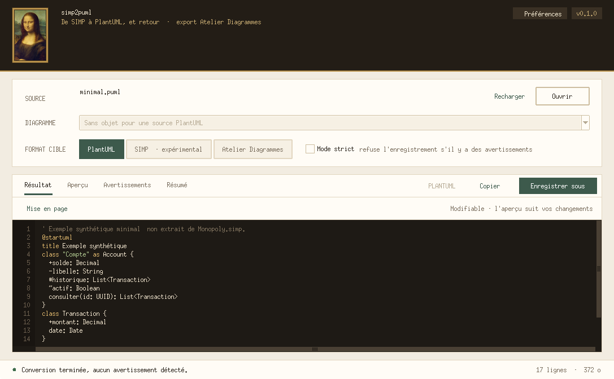

# Interface classique

L’installation fournit aussi `simp2puml-gui`, qui ouvre l’interface choisie dans les préférences (voir [Préférences](editeur.md#preferences)). L’interface classique décrite ici s’ouvre directement avec `python -m simp2puml.gui [fichier]` : une fenêtre Tkinter sans dépendance supplémentaire. Elle exige un Python livré avec Tk : c’est le cas des installateurs Windows et macOS de python.org ; sous Linux, installer le paquet de la distribution (`python3-tk` sous Debian/Ubuntu, `python3-tkinter` sous Fedora).

- **Ouvrir…** (Ctrl+O) choisit une source `.simp` ou `.puml` ; le résultat PlantUML est présélectionné (un `.puml` est montré tel quel, sans conversion ; choisir SIMP ou Atelier pour le convertir). Pour un projet SIMP, la liste propose chaque vue (nom et type) et, s’il y en a plusieurs, l’équivalent de `--all`, qui force la sortie PlantUML.
- Chaque changement d’option relance la conversion en mémoire ; les onglets montrent le résultat, les avertissements et le résumé de la CLI. **Recharger** (F5) relit la source après une modification externe.
- **Mode strict** se comporte comme `--strict` : le résultat reste consultable, mais ne peut pas être enregistré tant que des avertissements existent.
- **Enregistrer sous…** (Ctrl+S) relit et reconvertit la source avant la publication atomique. Comme la CLI, l’interface refuse d’écrire sur la source ou sur un fichier existant : choisir un autre nom plutôt que remplacer un document.
- Raccourcis : Ctrl+1 à Ctrl+4 pour les onglets Résultat, Aperçu, Avertissements et Résumé ; Ctrl+Maj+C copie le résultat.

## Modifier le résultat

L’onglet **Résultat** est un éditeur : coloration syntaxique en direct (PlantUML, Atelier, XML SIMP), annulation illimitée (Ctrl+Z, Ctrl+Y), indentation automatique et numéros de ligne. Pour une sortie PlantUML, l’aperçu suit le texte modifié environ 0,3 s après la dernière frappe, et une erreur de syntaxe surligne la ligne fautive dans l’éditeur.

**Enregistrer sous…**, **Copier** et **Exporter l’image…** utilisent la version modifiée ; elle est enregistrée telle quelle, sans reconversion ni mode strict, et sans jamais remplacer un fichier existant. « Rétablir la conversion » revient au texte généré. Changer une option, recharger ou ouvrir un autre fichier demande confirmation avant de remplacer des modifications.

Le menu **Mise en page** modifie le texte PlantUML (chaque action s’annule en une étape) :
- **Suivre la disposition SIMP** (coché par défaut) : décoché, les indications de position (directions des liens, liens invisibles) sont retirées et PlantUML place tout librement. Pour les retrouver : Ctrl+Z ou « Rétablir la conversion ».
- **Préréglage : page portrait** : disposition libre, hiérarchie de gauche à droite et notes coupées. Monopoly passe de ≈ 4 100 × 2 400 px (disposition SIMP) à ≈ 1 500 × 4 200 px, pour une page de document en portrait.
- Directives à cocher : hiérarchie de gauche à droite (`left to right direction`), notes coupées à 200 px (`skinparam wrapWidth 200`), compartiments vides masqués, liens à angle droit (`skinparam linetype ortho`, sans effet avec la mise en page intégrée `smetana` : il faut Graphviz).

Dans l’aperçu, « Ajuster » descend jusqu’à 10 % pour montrer un grand diagramme en entier.

## Aperçu et export d'images

L’onglet **Aperçu** dessine le diagramme sélectionné et se met à jour à chaque changement d’option, quel que soit le format cible : une source `.puml` est rendue telle quelle, une source SIMP est convertie en PlantUML en mémoire (le mode strict ne bloque pas l’aperçu). Zoom net (−, +, Ajuster, Taille réelle, Ctrl+molette), déplacement à la souris et navigation entre les pages quand « Tous les diagrammes » produit plusieurs vues. **Exporter l’image…** enregistre en PNG, PNG ×2, SVG, EPS ou texte ASCII ; plusieurs vues donnent `nom-1.png`, `nom-2.png`… Comme pour les conversions, aucun fichier existant n’est remplacé.

Le rendu est local : [PlantUML](https://plantuml.com) s’exécute sur l’ordinateur, rien n’est envoyé à un serveur. Le profil de sécurité `SANDBOX` interdit toute lecture de fichier local ou d’URL (le profil `SECURE` autorise encore `!include` de fichiers `.puml` locaux) ; la bibliothèque standard de PlantUML (`!include <C4/…>`) reste disponible. Sans Graphviz, la mise en page intégrée `smetana` est utilisée.

**Vitesse.** L’aperçu utilise l’exécutable **natif** de PlantUML (compilé, sans Java), publié pour Windows x64, Linux x64/arm64 et macOS Apple Silicon ; ailleurs (macOS Intel…), Java + plantuml.jar prend le relais. Deux processus PlantUML restent ouverts pendant la session (mode `-pipe`) : l’un calcule la mise en page en SVG pour connaître la taille, l’autre dessine le PNG directement à la résolution affichée.

Ils démarrent avec la fenêtre, et l’aperçu est préparé dès chaque conversion, avant même l’ouverture de l’onglet. Un grand diagramme montre d’abord une ébauche à demi-résolution, puis la version nette ; un rendu devenu inutile (option changée entre-temps) est interrompu. Mesures sur Windows 11 : petit diagramme ≈ 10 ms au lieu de 1,3 s ; Monopoly (≈ 10 800 px de large) ébauche à 0,6 s et image nette à 1,6 s au lieu d’environ 4 s.

Une erreur de syntaxe pendant l’édition laisse la dernière image valide affichée, avec le message et la ligne fautive. Les exports SVG passent par le processus ouvert ; les autres formats par un processus isolé.

Si le moteur manque, l’onglet propose de l’installer en un clic, dans le même dossier de données que les lanceurs : PlantUML 1.2026.9 natif (≈ 50 Mo) ou, à défaut, plantuml.jar (≈ 29 Mo) et si nécessaire Java 21 Eclipse Temurin (≈ 48 Mo, somme fournie par l’API Adoptium). Les sommes SHA-256 de PlantUML sont fixées dans `render.py`. `SIMP2PUML_PLANTUML` (exécutable natif), `PLANTUML_JAR`, `SIMP2PUML_JAVA` et `JAVA_HOME` permettent d’utiliser des installations existantes. PlantUML est téléchargé depuis ses publications officielles (licence GPL) et n’est pas redistribué avec ce projet.

Les proportions suivent le nombre d’or φ là où il sert la mise en page (constantes en tête de `gui.py`) : fenêtre et portrait en rectangle d’or, échelle typographique de raison √φ (8 à 26 pt), espacements de Fibonacci (3, 5, 8, 13, 21, 34 px), espace libre vertical réparti 1 : φ (écran d’accueil, carte d’installation, aperçu) et tuiles du résumé au rapport φ². L’icône reste carrée, comme l’exigent les systèmes.

L’icône et le portrait reproduisent *La Joconde* de Léonard de Vinci (domaine public), d’après la reproduction « Mona Lisa, by Leonardo da Vinci, from C2RMF retouched » de Wikimedia Commons. Les images de `src/simp2puml/assets/` se régénèrent avec `tools/build-icons.py` (Pillow requis pour cet outil uniquement).
